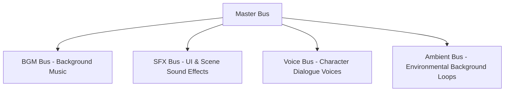

# Audio System Guide (`audio.md`)

<p align="center">
  <b>English</b> • <a href="../ru/audio.md"><b>Русский</b></a>
</p>

The **DariVN** engine features a comprehensive multi-channel audio mixer built on top of the battle-tested **miniaudio** library. The audio pipeline provides seamless background music crossfading, volume fades, polyphonic sound effects, voice acting synchronization, and automatic audio ducking.

---

## Table of Contents

* [Audio Bus Architecture](#audio-bus-architecture)
* [Background Music (BGM) & Seamless Crossfades](#background-music-bgm--seamless-crossfades)
* [Sound Effects (SFX)](#sound-effects-sfx)
* [Dialogue Voice Acting (Voice)](#dialogue-voice-acting-voice)
* [Environmental Ambient Loops (Ambient / BGS)](#environmental-ambient-loops-ambient--bgs)
* [Automatic Audio Ducking](#automatic-audio-ducking)
* [Supported Audio Formats](#supported-audio-formats)
* [Configuring Default Volume Levels](#configuring-default-volume-levels)
* [Related Documentation](#related-documentation)

---

## Audio Bus Architecture

Audio playback is divided into 5 independent mixer channels:



Each bus volume can be adjusted independently via the Settings menu or through `assets/config.vn`.

---

## Background Music (BGM) & Seamless Crossfades

### Playing Music (`play music`)
```ini
# Format: play music <path> [loop|noloop] [fade <seconds>] [volume <gain>]
play music "assets/audio/bgm/theme.mp3" loop fade 1.5 volume 0.8
```

### Parameters:
* `loop` / `noloop` — Whether to loop playback continuously (defaults to `loop`).
* `fade <seconds>` — Fade-in transition duration in seconds.
* `volume <0.0 .. 1.0>` — Individual track volume multiplier.

### Automatic Crossfades
When playing a new music track while another is already active, specifying a `fade` parameter triggers an **automatic crossfade**: the previous track fades out smoothly while the new track fades in simultaneously:

```ini
play music "assets/audio/bgm/calm_theme.mp3" loop fade 2.0
dari "The classroom was peaceful and warm..."

# Seamlessly crossfade to suspense music:
play music "assets/audio/bgm/suspense.mp3" loop fade 2.0
dari "Suddenly, heavy footsteps echoed through the hallway..."
```

### Stopping Music (`stop music`)
```ini
# Smooth fade-out over 2 seconds:
stop music fade 2.0

# Instant stop:
stop music
```

---

## Sound Effects (SFX)

Sound effects run polyphonically without interrupting background music or ambient loops:

```ini
# Format: play sound <path> [volume <gain>]
play sound "assets/audio/sfx/bell.wav"
play sound "assets/audio/sfx/door_slam.wav" volume 0.9

# (Alias: play sfx)
play sfx "assets/audio/sfx/click.wav"
```

* Multiple sounds can play at the same time.
* UI button click audio is globally defined via `ui.click_sound` in `config.vn`.

---

## Dialogue Voice Acting (Voice)

The dedicated Voice channel handles spoken character lines:

```ini
# Format: play voice <path> [volume <gain>]
play voice "assets/audio/voice/dari_greeting.mp3"
dari "Hello there! Glad to meet you!"
```

### Automatic Interruption
DariVN automatically stops active voice playback (`StopVoice`) as soon as the player advances to the **next dialogue line**. This prevents spoken lines from overlapping when the player clicks quickly through dialogues.

To stop voice playback manually:
```ini
stop voice
```

---

## Environmental Ambient Loops (Ambient / BGS)

The Ambient channel plays continuous environmental soundscapes: rainstorms, rooftop winds, night crickets, or crowded school corridors.

Ambient audio plays **in parallel** with background music (BGM):

```ini
# Start gentle rooftop wind with a 2-second fade-in:
play ambient "assets/audio/ambient/wind.mp3" loop fade 2.0 volume 0.7

# Change location to rainy street:
play ambient "assets/audio/ambient/rain.mp3" loop fade 1.5

# Stop ambient sounds:
stop ambient fade 2.0
```

---

## Automatic Audio Ducking

To provide a polished cinematic feel, DariVN implements automatic **Audio Ducking**:
* When the player opens the **Pause Menu (`Escape`)** or the **Dialogue History / Backlog (`L` or Mouse Wheel Up)**, the engine smoothly attenuates BGM and Ambient volume (down to ~35%).
* When returning to gameplay, volume smoothly returns to its original level.
* This keeps UI clicks clear and helps the player concentrate on reading the backlog or adjusting settings.

---

## Supported Audio Formats

Via `miniaudio`, DariVN decodes major audio formats without external system dependencies:
* **MP3** (`.mp3`) — Recommended for music and voice tracks.
* **WAV** (`.wav`) — Ideal for short, low-latency sound effects.
* **FLAC** (`.flac`) — Lossless high-fidelity audio.
* **OGG Vorbis** (`.ogg`).

---

## Configuring Default Volume Levels

Base audio settings are declared in `assets/config.vn`:

```ini
audio.master_volume = 1.0     # Master volume (0.0 - 1.0)
audio.bgm_volume = 0.8        # Music volume
audio.sfx_volume = 1.0        # Sound effects volume
audio.voice_volume = 1.0      # Voice acting volume
audio.ambient_volume = 0.7    # Environmental ambient volume
audio.bgm_crossfade = 1.5     # Default music crossfade duration in seconds

ui.click_sound = "assets/audio/sfx/click.wav"
menu.music = "assets/audio/bgm/menu_theme.mp3"
```

Player volume adjustments are saved in `saves/settings.vn`.

---

## Related Documentation

* [Documentation Index](README.md)
* [Writing Scenarios](scenario.md)
* [Engine Configuration](configuration.md)
* [Saves & Architecture](saves_and_architecture.md)
