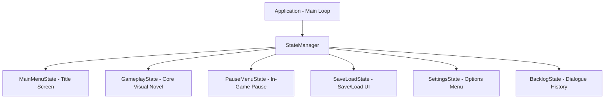

# Saves, Persistent Data & Architecture Guide (`saves_and_architecture.md`)

<p align="center">
  <b>English</b> • <a href="../ru/saves_and_architecture.md"><b>Русский</b></a>
</p>

This document explains the internal architecture of **DariVN**, the save/load system, persistent meta-variables, dialogue backlog mechanics, and the engine's Finite State Machine.

---

## Table of Contents

* [Save & Load System](#save--load-system)
  * [Save Slots & File Structure](#save-slots--file-structure)
  * [QuickSave and QuickLoad](#quicksave-and-quickload)
  * [Serialized State Data](#serialized-state-data)
  * [Visual Screenshot Thumbnails](#visual-screenshot-thumbnails)
* [Global Persistent Variables (`persistent.json`)](#global-persistent-variables-persistentjson)
* [Dialogue History Window (Backlog)](#dialogue-history-window-backlog)
* [Engine Architecture & State Machine](#engine-architecture--state-machine)
  * [Game States Breakdown](#game-states-breakdown)
  * [Rendering Pipeline (`RenderPipeline`)](#rendering-pipeline-renderpipeline)
  * [Shared Context (`SharedContext`)](#shared-context-sharedcontext)
* [Related Documentation](#related-documentation)

---

## Save & Load System

Save state operations are encapsulated inside `SaveManager`. By default, save files are stored in the `saves/` folder.

### Save Slots & File Structure

Each save slot consists of two associated files:
1. `slot_<N>.json` — Complete serialized game state in JSON format.
2. `slot_<N>.png` — Real-time screenshot captured when the save was created.

QuickSave uses `quicksave.json` and `quicksave.png`.

```text
saves/
├── slot_1.json
├── slot_1.png
├── slot_2.json
├── slot_2.png
├── quicksave.json
├── quicksave.png
├── persistent.json      # Global persistent variables
└── settings.vn          # User display and audio preferences
```

### QuickSave and QuickLoad
* **`F5`** — Instant QuickSave without opening menus.
* **`F9`** — Instant QuickLoad from the QuickSave slot.

Toast notifications pop up in the top-right corner confirming the operation.

### Serialized State Data
DariVN saves the exact state of the narrative:
* **Script Progress:** Script path, active command index, current speaker, dialogue text.
* **Dialogue Mode:** ADV or NVL mode, and all accumulated NVL page lines.
* **Scene Background:** Background image path, active custom shader ID, and custom uniform parameters.
* **Active Characters:** Positions (X, Y), named slots, expressions, layer Z-indices, color tints, silhouette toggles, sepia levels, attached custom shaders, and uniform states.
* **Interactive Choices:** Active choices if saved during a decision prompt.
* **Variables:** All runtime `$variables`.
* **Audio Channels:** Active BGM track, volume, loop flag, and active ambient soundscapes.
* **Dialogue History:** Accumulated backlog history.
* **Post-Processing:** Vignette, sepia, and blur levels.

### Visual Screenshot Thumbnails
Upon saving, pixels are read directly from the screen buffer via OpenGL `glReadPixels` and saved as PNG images using `stb_image_write`. In the Save/Load menu, players see real screenshot previews along with the date, speaker name, and dialogue quote.

---

## Global Persistent Variables (`persistent.json`)

Standard variables `$var` are tied to specific save slots. However, visual novels require **meta-variables** that survive loading, saving, and starting a new game:
* Total game launch counter.
* Unlocked endings (True Ending, Bad Ending, Route Clear).
* CG Gallery artwork unlocks.
* Read text history for the dialogue skip system.

Any variable starting with `$global.` or `$persistent.` (e.g. `$global.counter`, `$persistent.true_ending`) is automatically routed to `SaveManager`'s persistent store:

```ini
# Increment global game launch counter:
$global.started_counter += 1

# Unlock true ending flag:
$persistent.true_ending_unlocked = true

# Conditional check in script:
if $persistent.true_ending_unlocked jump true_ending_epilogue
```

Persistent data is saved automatically in `saves/persistent.json`.

---

## Dialogue History Window (Backlog)

The Backlog lets players review dialogue lines they may have missed:

### Controls:
* **Open Backlog:** Press **`L`**, scroll the **Mouse Wheel Up**, or click "History" on the quick menu.
* **Scroll:** Mouse wheel, `Up` / `Down` arrows, `Page Up` / `Page Down`.
* **Close Backlog:** Press **`Escape`**, **Right-Click**, or click "Close".

When the backlog opens:
1. Gameplay execution pauses.
2. Background music and ambient loops are smoothly ducked (Audio Ducking).
3. Past dialogue entries retain their formatting and character nameplates.

---

## Engine Architecture & State Machine

DariVN uses a component-based Finite State Machine architecture:



### Game States Breakdown:
* **`MainMenuState`** — Title screen with New Game, Load, Settings, cyclical language selector, and Exit.
* **`GameplayState`** — Heart of the engine. Coordinates `StoryEngine`, handles input, renders backgrounds, characters, `DialogueBox`, `ChoiceMenu`, and toast notifications.
* **`PauseMenuState`** — Triggered via `Escape`. Captures the scene FBO and applies a Gaussian blur shader behind menu options.
* **`SaveLoadState`** — Visual slot grid with screenshot previews, timestamps, and save/load/delete actions.
* **`SettingsState`** — Interactive sliders for audio buses, text speed, VSync, fullscreen toggles, and language switching.
* **`BacklogState`** — Scrollable dialogue history view.

### Rendering Pipeline (`RenderPipeline`)
The `RenderPipeline` subsystem manages:
* Initializing and resizing two full-resolution Framebuffers (FBO).
* Compiling and caching GLSL shaders (`ShaderManager`, `Shader`).
* Orthographic quad batching (`SpriteRenderer`).
* Vector TrueType font rasterization and atlas management (`TextRenderer`).

### Shared Context (`SharedContext`)
States share common subsystems via `SharedContext`:
* `Window` — GLFW window handling and mouse/keyboard inputs.
* `AudioEngine` — miniaudio multi-channel mixer.
* `ResourceManager` — Central texture, font, and shader cache.
* `StateManager` — State transition controls (Push, Pop, Change).

### Virtual File System (VFS)
All game assets are resolved through `DariVN::VFS`. It abstracts physical and packaged storage:
* Supports reading from both physical directories and packed `.pak` archives (`game.pak` / `assets.pak`).
* Enables zero-overhead streaming directly into GPU memory and audio decoders.
* Features a Developer Mode (`--dev`) for hot-reloading raw disk assets during production without repacking.
* Learn more in the [Asset Packer & VFS Guide](packer.md).

---

## Related Documentation

* [Documentation Index](README.md)
* [Asset Packer & VFS](packer.md)
* [Writing Scenarios](scenario.md)
* [Character Configuration](characters.md)
* [Shaders & Special Effects](shaders.md)
* [Engine Configuration](configuration.md)
* [Audio System](audio.md)

