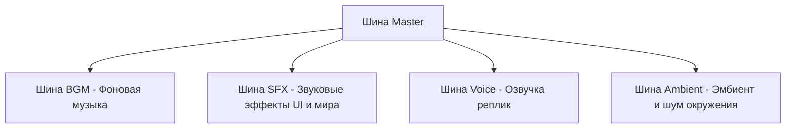

# Аудиосистема (`audio.md`)

<p align="center">
  <b>Русский</b> • <a href="../en/audio.md"><b>English</b></a>
</p>

Движок **DariVN** оснащён продвинутой многоканальной аудиосистемой на базе высокопроизводительной кроссплатформенной библиотеки **miniaudio**. Звуковой движок полностью интегрирован в язык сценариев `.vn` и поддерживает кроссфейд, плавные затухания, зацикливание и автоматическое приглушение звука при открытии меню (Ducking).

---

## Содержание

* [Архитектура аудиошин](#архитектура-аудиошин)
* [Фоновая музыка (BGM) и плавный кроссфейд](#фоновая-музыка-bgm-и-плавный-кроссфейд)
* [Звуковые эффекты (SFX)](#звуковые-эффекты-sfx)
* [Озвучка диалогов (Voice)](#озвучка-диалогов-voice)
* [Фоновый эмбиент (Ambient / BGS)](#фоновый-эмбиент-ambient--bgs)
* [Приглушение звука (Audio Ducking)](#приглушение-звука-audio-ducking)
* [Поддерживаемые аудиоформаты](#поддерживаемые-аудиоформаты)
* [Конфигурация уровней громкости](#конфигурация-уровней-громкости)
* [Связанные документы](#связанные-документы)

---

## Архитектура аудиошин

Аудиопотоки разделены на 5 независимых шин громкости:



Каждая шина настраивается независимо в меню настроек игры или в файле `assets/config.vn`.

---

## Фоновая музыка (BGM) и плавный кроссфейд

### Запуск музыки (`play music`)
```ini
# Формат: play music <путь> [loop|noloop] [fade <секунды>] [volume <множитель>]
play music "assets/audio/bgm/theme.mp3" loop fade 1.5 volume 0.8
```

### Параметры:
* `loop` / `noloop` — зацикливать ли трек (по умолчанию `loop`).
* `fade <секунды>` — время плавного нарастания громкости (Fade In) в секундах.
* `volume <0.0 .. 1.0>` — индивидуальная громкость данного трека.

### Автоматический кроссфейд (Crossfade)
Если в сценарии играет музыка, и вы вызываете команду `play music` с параметром `fade`, движок **автоматически плавно приглушает старый трек, одновременно поднимая громкость нового**:
```ini
play music "assets/audio/bgm/calm_theme.mp3" loop fade 2.0
dari "В классе было тихо и спокойно..."

# Автоматический кроссфейд на тревожную музыку:
play music "assets/audio/bgm/suspense.mp3" loop fade 2.0
dari "Но вдруг в коридоре послышались шаги..."
```

### Остановка музыки (`stop music`)
```ini
# Плавная остановка за 2 секунды:
stop music fade 2.0

# Мгновенная остановка:
stop music
```

---

## Звуковые эффекты (SFX)

Звуковые эффекты воспроизводятся параллельно без прерывания музыки и эмбиента:

```ini
# Формат: play sound <путь> [volume <громкость>]
play sound "assets/audio/sfx/bell.wav"
play sound "assets/audio/sfx/door_slam.wav" volume 0.9

# (Синоним: play sfx)
play sfx "assets/audio/sfx/click.wav"
```

* Несколько звуковых эффектов могут звучать одновременно (полифоническое воспроизведение).
* Звук нажатия кнопок в меню настраивается глобально параметром `ui.click_sound` в `config.vn`.

---

## Озвучка диалогов (Voice)

Канал озвучки предназначен для озвучивания персонажей в новелле:

```ini
# Формат: play voice <путь> [volume <громкость>]
play voice "assets/audio/voice/dari_greeting.mp3"
dari "Привет! Рада познакомиться!"
```

### Автоматическая остановка
Движок DariVN автоматически останавливает текущую фразу озвучки (`StopVoice`), как только игрок переходит к **следующей реплике диалога**. Это гарантирует, что фразы разных персонажей не будут накладываться друг на друга при быстром пролистывании текста.

Принудительная остановка:
```ini
stop voice
```

---

## Фоновый эмбиент (Ambient / BGS)

Канал эмбиента воспроизводит длительные фоновые звуки природы и окружения: дождь, ветер на крыше, пение цикад, гул школьного коридора.

Эмбиент играет **параллельно** с фоновой музыкой BGM, создавая глубокую пространственную атмосферу:

```ini
# Запуск шума ветра с плавным нарастанием за 2 секунды:
play ambient "assets/audio/ambient/wind.mp3" loop fade 2.0 volume 0.7

# Смена локации на дождливую улицу:
play ambient "assets/audio/ambient/rain.mp3" loop fade 1.5

# Остановка шума окружения:
stop ambient fade 2.0
```

---

## Приглушение звука (Audio Ducking)

Для создания кинематографичного комфорта движок DariVN реализует автоматический **Audio Ducking**:
* Когда игрок открывает **Меню паузы (`Escape`)** или **Историю диалогов / Бэклог (`L` или колёсико вверх)**, громкость фоновой музыки (BGM) и эмбиента плавно приглушается (до ~35%).
* При возврате в игровой процесс музыка плавно возвращается к нормальному уровню громкости.
* Это позволяет чётко слышать звуки интерфейса и не отвлекает игрока во время чтения бэклога или настройки опций.

---

## Поддерживаемые аудиоформаты

Библиотека `miniaudio` нативно декодирует следующие форматы без установки сторонних кодеков:
* **MP3** (`.mp3`) — оптимально для фоновой музыки и озвучки.
* **WAV** (`.wav`) — рекомендуется для коротких звуковых эффектов (SFX).
* **FLAC** (`.flac`) — lossless-аудио высокого качества.
* **OGG Vorbis** (`.ogg`).

---

## Конфигурация уровней громкости

Базовые громкости задаются в `assets/config.vn`:

```ini
audio.master_volume = 1.0     # Мастер-громкость (0.0 - 1.0)
audio.bgm_volume = 0.8        # Громкость фоновой музыки
audio.sfx_volume = 1.0        # Громкость звуковых эффектов
audio.voice_volume = 1.0      # Громкость голосов персонажей
audio.ambient_volume = 0.7    # Громкость эмбиента
audio.bgm_crossfade = 1.5     # Длительность кроссфейда музыки по умолчанию (сек)

ui.click_sound = "assets/audio/sfx/click.wav"
menu.music = "assets/audio/bgm/menu_theme.mp3"
```

Игрок может регулировать каждую шину отдельно в меню настроек (`SettingsState`), при этом его личные предпочтения сохраняются в файл `saves/settings.vn`.

---

## Связанные документы

* [Главная страница документации](README.md)
* [Написание сценариев](scenario.md)
* [Конфигурация движка](configuration.md)
* [Архитектура и сохранения](saves_and_architecture.md)
