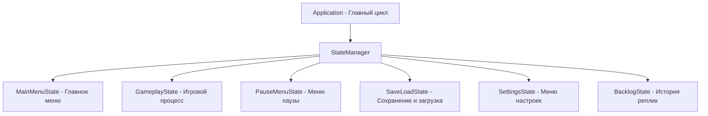

# Сохранения, архитектура и управление состоянием (`saves_and_architecture.md`)

<p align="center">
  <b>Русский</b> • <a href="../en/saves_and_architecture.md"><b>English</b></a>
</p>

В данном документе рассматривается устройство системы сохранений, механизм персистентных глобальных переменных, окно истории диалогов (бэклог) и общая архитектура подсистем движка **DariVN**.

---

## Содержание

* [Система сохранений (Save & Load)](#система-сохранений-save--load)
  * [Слоты сохранений и структура файлов](#слоты-сохранений-и-структура-файлов)
  * [Быстрое сохранение (QuickSave)](#быстрое-сохранение-quicksave)
  * [Что именно сериализуется](#что-именно-сериализуется)
  * [Генерация скриншотов предпросмотра](#генерация-скриншотов-предпросмотра)
* [Глобальные персистентные переменные (`persistent.json`)](#глобальные-персистентные-переменные-persistentjson)
* [История диалогов (Бэклог / Backlog)](#история-диалогов-бэклог--backlog)
* [Архитектура движка и машина состояний (State Machine)](#архитектура-движка-и-машина-состояний-state-machine)
  * [Список игровых состояний](#список-игровых-состояний)
  * [Графический конвейер (RenderPipeline)](#графический-конвейер-renderpipeline)
  * [Контекст совместного использования (SharedContext)](#контекст-совместного-использования-sharedcontext)
* [Связанные документы](#связанные-документы)

---

## Система сохранений (Save & Load)

Управление сохранениями инкапсулировано в классе `SaveManager`. Все файлы сохранений по умолчанию записываются в каталог `saves/`.

### Слоты сохранений и структура файлов

Каждому сохранению соответствуют два файла:
1. `slot_<N>.json` — полное состояние игры в формате JSON.
2. `slot_<N>.png` — скриншот предпросмотра экрана в момент сохранения.

Для слота быстрого сохранения используются имена `quicksave.json` и `quicksave.png`.

```text
saves/
├── slot_1.json
├── slot_1.png
├── slot_2.json
├── slot_2.png
├── quicksave.json
├── quicksave.png
├── persistent.json      # Глобальные переменные
└── settings.vn          # Пользовательские настройки звука и экрана
```

### Быстрое сохранение (QuickSave)
* **`F5`** — Мгновенное быстрое сохранение игры без открытия меню.
* **`F9`** — Быстрая загрузка из слота QuickSave.

В правом верхнем углу экрана выводится всплывающее уведомление (Toast) с подтверждением операции.

### Что именно сериализуется
Движок производит полный снимок текущего состояния сюжета:
* **Сценарий:** путь к текущему `.vn` файлу, индекс выполняемой команды, текущий говорящий, текст реплики.
* **Режим диалога:** обычный ADV или полноэкранный NVL, а также все строки текущей страницы NVL.
* **Фон сцены:** путь к фону, активный кастомный шейдер фона и его текущие uniform-параметры.
* **Персонажи на сцене:** для каждого активного героя сохраняются координаты (X, Y), слот, эмоция, слой Z-index, индивидуальные цветовые тонировки (tint), силуэт, сепия, активный шейдер персонажа и его параметры.
* **Интерактивные выборы:** если игрок сохранился на развилке, сохраняется список вариантов, их условия и доступность.
* **Переменные сюжета:** все значения скриптовых переменных `$variable`.
* **Аудиопотоки:** играющий трек BGM, его громкость, зацикливание, активный эмбиент.
* **История реплик (бэклог):** вся накопленная история прочитанных диалогов.
* **Экранные пост-эффекты:** текущие значения виньетки, сепии, размытия.

### Генерация скриншотов предпросмотра
При сохранении движок считывает пиксели из экранного буфера через OpenGL `glReadPixels`, после чего библиотека `stb_image_write` сохраняет компактный PNG-файл. В меню сохранения и загрузки игрок видит реальный скриншот сцены, имя персонажа, текст реплики и дату/время записи.

---

## Глобальные персистентные переменные (`persistent.json`)

Обычные переменные `$var` привязаны к конкретному слоту сохранения. Однако для визуальных новелл критически важны **мета-переменные**, которые должны сохраняться независимо от сохранений и загрузок:
* Счётчик общего количества запусков игры.
* Открытые концовки сюжета (True Ending, Bad Ending).
* Разблокированные иллюстрации в галерее артов (CG Gallery).
* Прочитанные реплики для работы режима пропуска текста (Skip Mode).

В DariVN любая переменная, имя которой начинается с префикса `$global.` или `$persistent.` (например, `$global.points`, `$persistent.ending_1`), автоматически перенаправляется в глобальное хранилище `SaveManager`:

```ini
# Увеличение глобального счётчика запусков
$global.started_counter += 1

# Разблокировка истинной концовки
$persistent.true_ending_unlocked = true

# Проверка в сценарии:
if $persistent.true_ending_unlocked jump true_ending_epilogue
```

Данные автоматически сохраняются в файл `saves/persistent.json`.

---

## История диалогов (Бэклог / Backlog)

Окно истории диалогов позволяет перечитать реплики, которые игрок случайно пропустил:

### Управление бэклогом:
* **Открыть историю:** Клавиша **`L`**, либо прокрутка **колёсика мыши вверх** во время игры, либо кнопка «История» в быстром меню.
* **Прокрутка:** Колёсико мыши, стрелки `Вверх` / `Вниз`, клавиши `Page Up` / `Page Down`.
* **Закрыть историю:** Клавиша **`Escape`**, клик **ПКМ**, либо кнопка «Закрыть».

При открытии бэклога:
1. Игровой процесс замораживается.
2. Фоновая музыка и эмбиент автоматически плавно приглушаются (Audio Ducking).
3. Все предыдущие реплики с именами персонажей отображаются с сохранением форматирования.

---

## Архитектура движка и машина состояний (State Machine)

Движок DariVN спроектирован по классической компонентной архитектуре игр.



### Список игровых состояний:
* **`MainMenuState`** — Главное меню игры (кнопки «Новая игра», «Загрузить», «Настройки», циклический переключатель языка, выход).
* **`GameplayState`** — Сердце новеллы. Координирует `StoryEngine`, обрабатывает ввод клавиатуры/мыши для перехода по репликам, отображает фоны, персонажей, диалоговое окно (`DialogueBox`), меню вариантов (`ChoiceMenu`) и плашки уведомлений (Toasts).
* **`PauseMenuState`** — Меню паузы. При вызове по `Escape` сцена игры копируется в текстуру и размывается гауссовым шейдером на фоне меню.
* **`SaveLoadState`** — Сетка слотов сохранений со скриншотами, временными метками и кнопками перезаписи/удаления.
* **`SettingsState`** — Ползунки громкости audio-шин, скорости вывода текста, тумблеры VSync, полноэкранного режима и языка интерфейса.
* **`BacklogState`** — Окно прокручиваемой истории реплик.

### Графический конвейер (RenderPipeline)
Класс `RenderPipeline` управляет:
* Инициализацией и ресайзом двух полноэкранных Framebuffer (FBO) размером с виртуальное окно.
* Сборкой и компиляцией базовых и пользовательских шейдеров (`ShaderManager`, `Shader`).
* Отрисовкой спрайтов через батчинг ортографической проекции (`SpriteRenderer`).
* Растеризацией глифов векторных TrueType-шрифтов через текстурный атлас (`TextRenderer`).

### Контекст совместного использования (SharedContext)
Состояния обмениваются ресурсами через структуру `SharedContext`, содержащую ссылки на:
* `Window` — окно GLFW и ввод.
* `AudioEngine` — звуковой микшер.
* `ResourceManager` — кэш текстур, шрифтов и шейдеров.
* `StateManager` — переключение состояний (Push, Pop, Change).

### Виртуальная файловая система (VFS)
Все ресурсы игры запрашиваются через класс `DariVN::VFS`. Он абстрагирует чтение файлов:
* Поддерживает одновременную работу с физическим диском и запакованными архивами `game.pak` / `assets.pak`.
* Обеспечивает мгновенный запуск и стриминг ресурсов напрямую в видеопамять и звуковой движок.
* Поддерживает режим разработчика (`--dev`) для работы с файлами на диске без переупаковки архивов.
* Подробнее: [Упаковщик ресурсов и VFS](packer.md).

---

## Связанные документы

* [Главная страница документации](README.md)
* [Упаковщик ресурсов и VFS](packer.md)
* [Написание сценариев](scenario.md)
* [Конфигурация персонажей](characters.md)
* [Шейдеры и визуальные спецэффекты](shaders.md)
* [Конфигурация движка](configuration.md)
* [Аудиосистема](audio.md)

